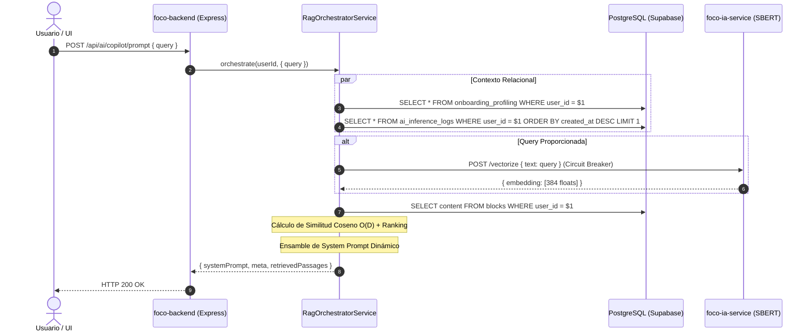

# 🧠 Orquestador RAG y Copiloto de IA (Fase 4)

Este documento detalla la arquitectura, endpoints y flujo de datos de la **Fase 4: Orquestación del Prompt RAG (Retrieval y Ensamble)** del proyecto F.O.C.O.

---

## 1. Flujo de Datos del Pipeline RAG



---

## 2. Endpoints Disponibles

### A. Ensamblar Prompt del Copiloto
- **Ruta:** `POST /api/ai/copilot/prompt` (o alias canónico `POST /api/ai/rag/assemble`)
- **Autenticación:** Requerida (`Bearer <JWT>`)
- **Body (Opcional):**
  ```json
  {
    "query": "No logro concentrarme en la entrega de matemáticas",
    "limit": 3,
    "threshold": 0.25,
    "customAction": null
  }
  ```
- **Respuesta (200 OK):**
  ```json
  {
    "systemPrompt": "[ROL Y PERSONALIDAD]\n...",
    "meta": {
      "userId": "uuid",
      "ruleId": "F_DISP_DESVIO_ESTUDIO",
      "actionTaken": "INJECT_CONVERSATIONAL_ALERT",
      "passagesCount": 1,
      "usedFallback": false,
      "timestamp": "2026-10-15T..."
    },
    "retrievedPassages": [
      {
        "id": "note-1",
        "blockType": "active_objectives",
        "title": "Entrega de Matemáticas",
        "text": "Ejercicios 1 a 10 de álgebra lineal",
        "type": "task",
        "similarity": 0.8841,
        "matchType": "vector"
      }
    ]
  }
  ```

### B. Obtener Prompt del Copiloto (Sin Payload)
- **Ruta:** `GET /api/ai/copilot/prompt`
- **Autenticación:** Requerida (`Bearer <JWT>`)
- **Descripción:** Ensambla el prompt en base a la regla más reciente y telemetría activa en tiempo real.

### C. Búsqueda Semántica en Bloques
- **Ruta:** `POST /api/ai/rag/search`
- **Autenticación:** Requerida (`Bearer <JWT>`)
- **Body:**
  ```json
  {
    "query": "ideas de diseño",
    "limit": 5,
    "threshold": 0.25
  }
  ```

---

## 3. Resiliencia y Fallbacks (Circuit Breaker)

1. **Microservicio SBERT caído o timeout >1500ms:** Conmuta a coincidencia léxica / palabras clave preservando la recuperación de notas.
2. **Sin logs de inferencia o sin regla activa:** Se inyecta contexto de contingencia ("Modo Acompañamiento Continuo") sin juzgar ni arrojar errores.
3. **Falla en base de datos:** Captura mediante Circuit Breaker devolviendo una plantilla segura con `meta.usedFallback: true`.
